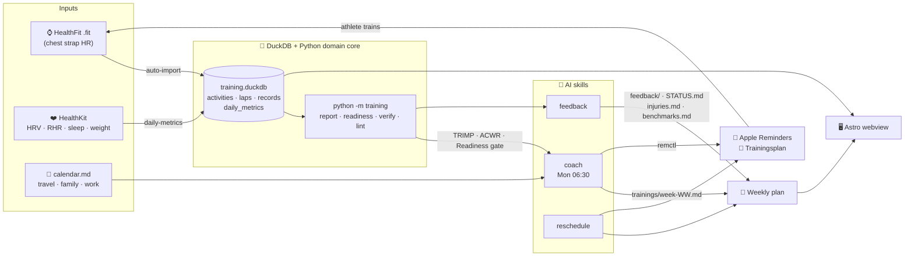

<div align="center">

# 🏃‍♂️ Training — an AI coach that lives in a git repo

**Personal running & strength training system for Florian.**
Markdown is the memory. DuckDB is the truth. AI agents are the coach.

[](https://github.com/floriankimmel/training/actions/workflows/ci.yml)


</div>

---

## 📈 By the numbers

<div align="center">

| 🏃 Runs | 📏 Running km | ⛰️ Running vert | 🚴 Rides | 🧬 Per-second records | 🗓️ Since |
|:---:|:---:|:---:|:---:|:---:|:---:|
| **1,497** | **19,214 km** | **201,534 m** | **876** | **10.7 M** | **Dec 2017** |

*Longest single run: **166 km**. That's 22.8× Mount Everest of running climb, all in one queryable database.*

</div>

---

## 🧠 How it works

The repo is a closed feedback loop. Every week runs through **Plan → Execute → Analyze → Adjust**, and every step leaves a trace in git.



| Step | Who | What happens |
|---|---|---|
| **1 · Plan** | `coach` skill | Runs the load/readiness report, reads race context, status, injuries and calendar. Writes `trainings/week-WW-YYYY.md` and mirrors every session to Apple Reminders with an `@workout` spec. |
| **2 · Execute** | Athlete | Trains off the phone. Chest strap on every run. HealthFit exports a `.fit` file. |
| **3 · Analyze** | `feedback` skill | Parses the `.fit`, grades the session against the plan, updates `STATUS.md`, `injuries.md`, `benchmarks.md`. |
| **4 · Adjust** | `reschedule` skill | Moves, swaps or cancels sessions across the plan *and* Reminders in one change when life gets in the way. |

---

## ✨ Highlights

- **🎯 Readiness gate, not vibes.** HRV (3-day z-score vs. 30 days), resting HR and sleep debt each raise at most one recovery flag → **GREEN / AMBER / RED**. Only the gate changes the plan. ([ADR 0002](docs/adr/0002-readiness-is-the-z-score-gate.md))
- **⛰️ Terrain-robust fitness metric.** *Pace in Zone*: median per-second pace inside a fixed HR band. Trail and flat runs are finally comparable. Result: **~1:00–1:20 min/km faster at the same HR (Z4) over 12 months**.
- **✅ Ticked off ≠ trained.** `python -m training verify` catches reminders marked done with no recorded activity. A GAP counts as *not trained*.
- **🔒 Single sources of truth, enforced by lint.** HR zones live only in `zones.md`. `scripts/lint.sh` checks symlinks, zone duplication, stale docs, the strength pointer and that Reminders match the weekly plan.
- **🧾 Decisions are written down.** Architecture choices are recorded as [ADRs](docs/adr/).
- **⏰ Runs itself.** Paperclip routines sync `.fit` and metrics daily and trigger the weekly plan every Monday at 06:30.
- **🗣️ Coached the way the athlete asked for.** Direct, critical, no sugarcoating.

---

## 👤 The athlete

- **Advanced endurance runner.** Many ultras finished, high training age, deep body awareness.
- **Parent-athlete.** Training fits around work and family. Consistency beats volume.
- **Flat home turf.** Wolkersdorf has ~60 m of max local climb. Vert must be *accumulated* (hill repeats, stairs, treadmill) or found in the Vienna Woods.
- **hrMax 180 bpm.** Targets in absolute bpm, never %. Recovery runs stay strict Z1, no ego.
- **Now:** base/build phase after toe fracture #2. Picking the 2027 target race. See [`STATUS.md`](STATUS.md).

---

## 🗺️ Repo map

```text
training/
├── 📍 STATUS.md            ← start here: where am I now (<60 lines)
├── 📜 STATUS-log.md        dated history
├── 👤 athlete.md           profile, goals, equipment, coaching style
├── ❤️ zones.md             HR zones (single source of truth)
├── 📖 GLOSSARY.md          canonical terms (Schwelle, Tempo, Z2-Block, Einheit)
├── 📅 calendar.md          future events that shape planning
├── 🩹 injuries.md          injury/illness log + return protocols
├── 🏆 benchmarks.md        PRs, test runs, reference paces
├── 💪 strength-plan.md     Mark Lauren bodyweight program pointer
├── 🍝 fueling.md           carb strategy (g/h per session type)
├── races/                  race files (current-race-*.md symlink = active target)
├── plans/                  macro plans + digitized strength program
├── trainings/              week-WW-YYYY.md weekly plans
├── feedback/               feedback-WW-YYYY.md session analyses
├── metrics/                daily HRV · RHR · sleep · weight
├── training/               🐍 Python domain core (zones, pace, readiness, report, verify, lint)
├── db/                     🦆 DuckDB + .fit importers
├── webview/                🖥️ Astro + React + Tailwind dashboard
├── scripts/                auto-import, lint, Paperclip routines
├── tests/                  pytest suite
└── docs/adr/               architecture decision records
```

---

## 🚀 Quick start

```bash
# install the domain core
python -m venv db/.venv
db/.venv/bin/pip install -e '.[dev]'

# load, readiness and outcome report (TRIMP, ACWR, Pace in Zone, weight trend)
db/.venv/bin/python -m training report

# ticked-off reminders without a recorded activity
db/.venv/bin/python -m training verify --days 7

# consistency check + tests (also run in CI)
bash scripts/lint.sh
db/.venv/bin/python -m pytest -q
```

Other subcommands: `insights`, `page`, `readiness`, `zones`.

---

## 📏 House rules

1. **HealthFit `.fit` is the only data source.** Parsed offline. No Strava, Tredict or Runalyze.
2. **Apple Reminders holds the schedule.** Any plan change is mirrored in the same commit. ([ADR 0003](docs/adr/0003-apple-reminders-holds-the-active-schedule.md))
3. **Living docs stay fresh.** Every file has a `Last updated` line; >30 days is flagged. See the maintenance contract in [`AGENTS.md`](AGENTS.md).
4. **Plan on Monday morning, never Sunday night.** Late Sunday runs need time to import.
5. **Lint before commit.** A pre-commit hook in `.githooks/` enforces it.

<div align="center">

---

*Built one Einheit at a time. 🦶 Two toe fractures, zero excuses.*

</div>
